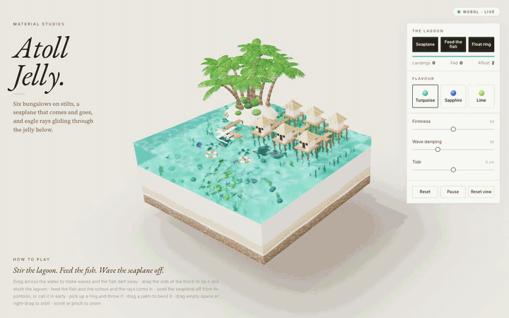

# Atoll Jelly

A small 3D toy: a floating diorama of a lagoon made of turquoise jelly. Six
bungalows on stilts, a seaplane that comes and goes, a school of fish and eagle
rays gliding under a wobbly, see-through water slab. Built with plain
Three.js (r170, loaded from unpkg through an import map). No build step.

## Demo

**Play it live: https://egor-xyz.github.io/island/**

[](https://egor-xyz.github.io/island/demo.mp4)

Click the GIF to watch the full 24-second video.

## Run

```sh
cd ~/my/island && python3 -m http.server 8000
```

Then open http://localhost:8000. Any static file server works.

## Play

- Drag across the water to make waves; the fish dart away from the stir point.
- Drag the side of the block to tip it; the lagoon sloshes and springs back.
- **Feed the fish**: food drops in, the school and the rays come to it.
- **Seaplane**: sends it off from the pontoon, or calls it in early when it is away.
- **Float ring**: drops a new ring. Pick a ring up and throw it; it arcs and splashes.
- Drag a palm to bend it.
- Drag empty space or right-drag to orbit; scroll or pinch to zoom.
- Flavour retints the jelly. Firmness sets the spring stiffness and wave speed,
  Wave damping sets how fast ripples die, Tide raises or lowers the water.

## How it works

- `main.js` runs a damped 2D wave equation on a 113 x 113 height field. The
  water mesh (top grid plus four side walls that follow the edge heights) is
  rebuilt from it every frame, and the island cells act as reflecting walls.
- The jelly is a `MeshPhysicalMaterial` with transmission and attenuation;
  caustics on the sand floor and the surface are a shader patch.
- Tipping, sloshing and the palm bend are spring systems driven by Firmness.
